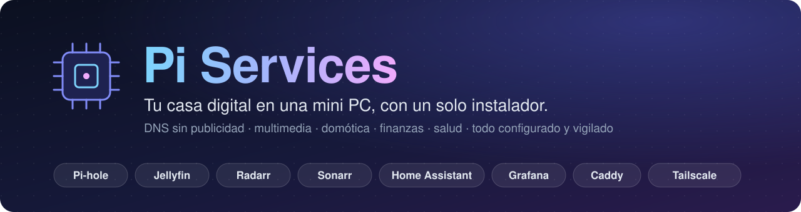
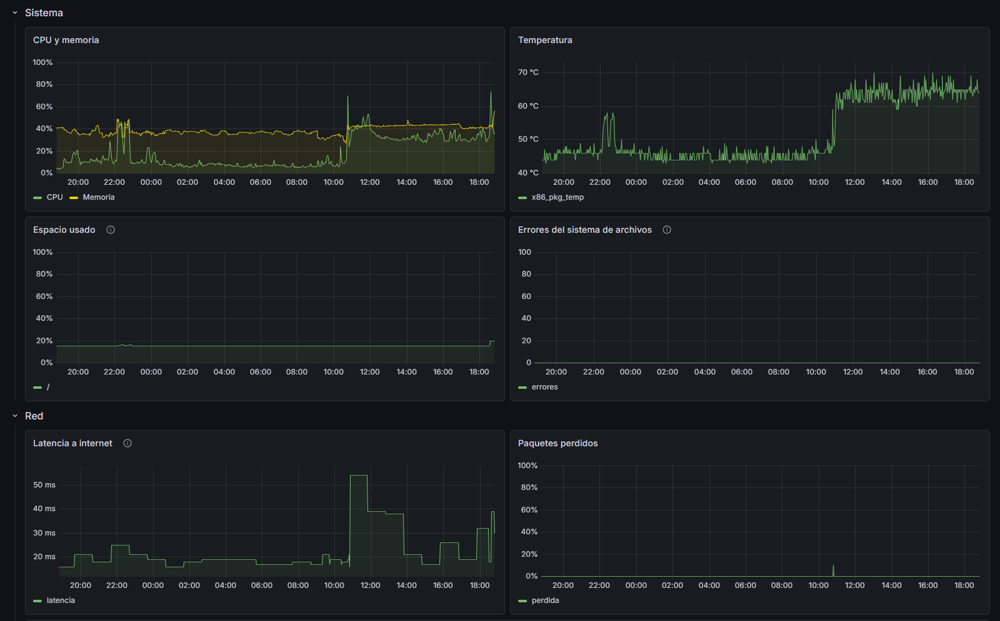
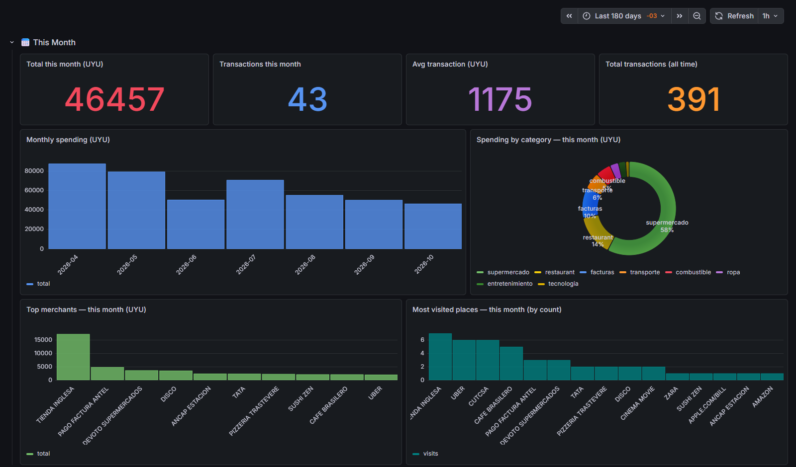
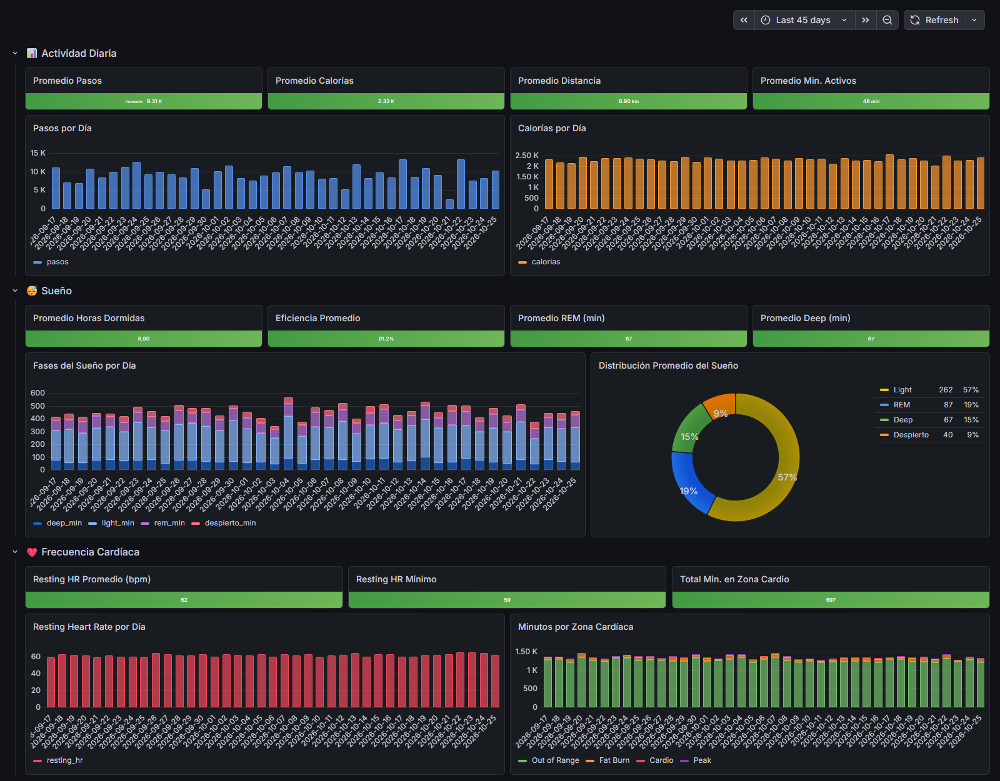
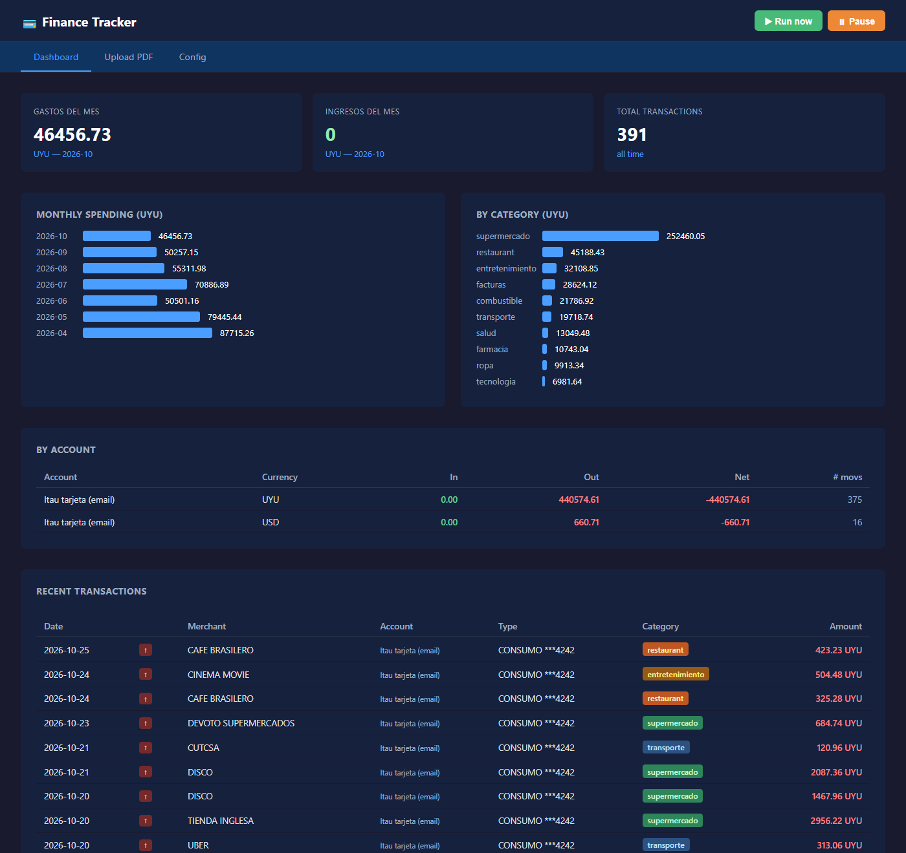
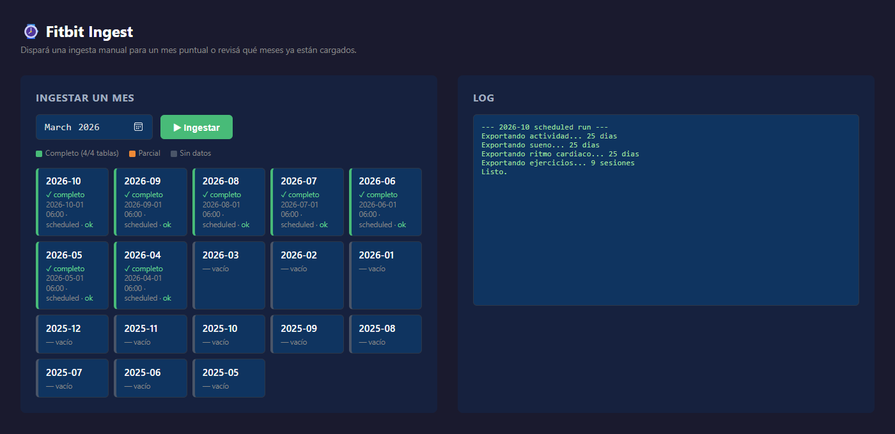
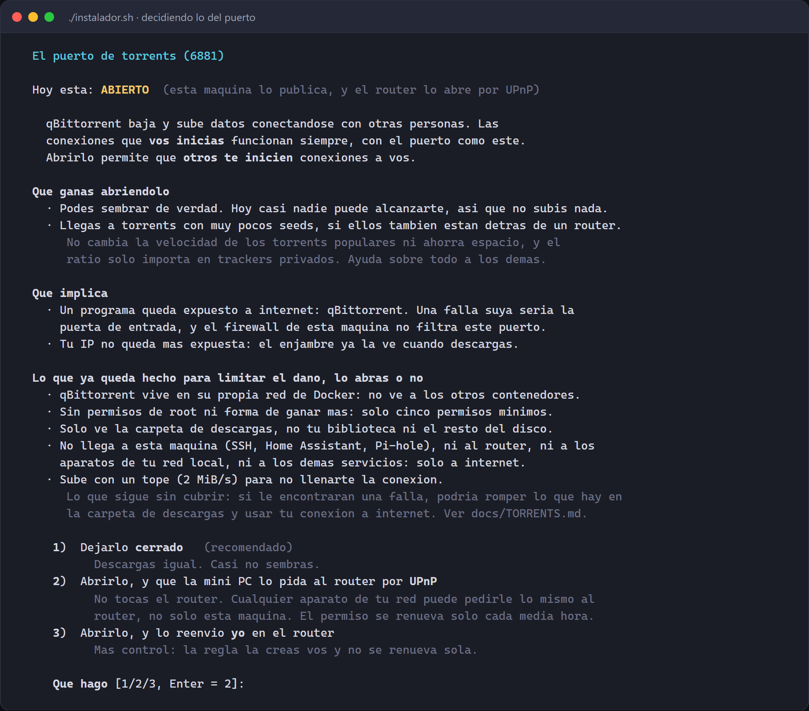
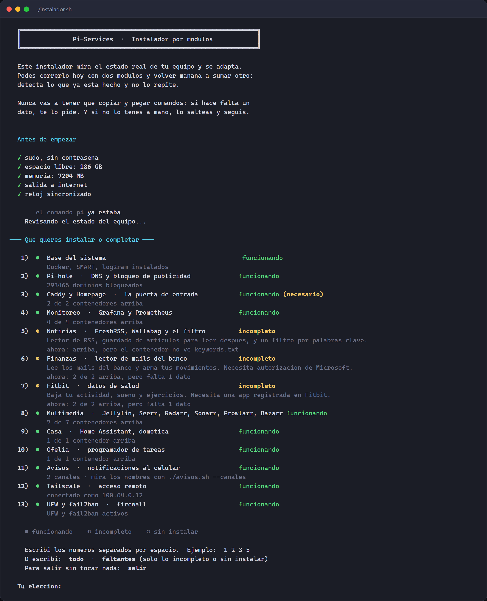
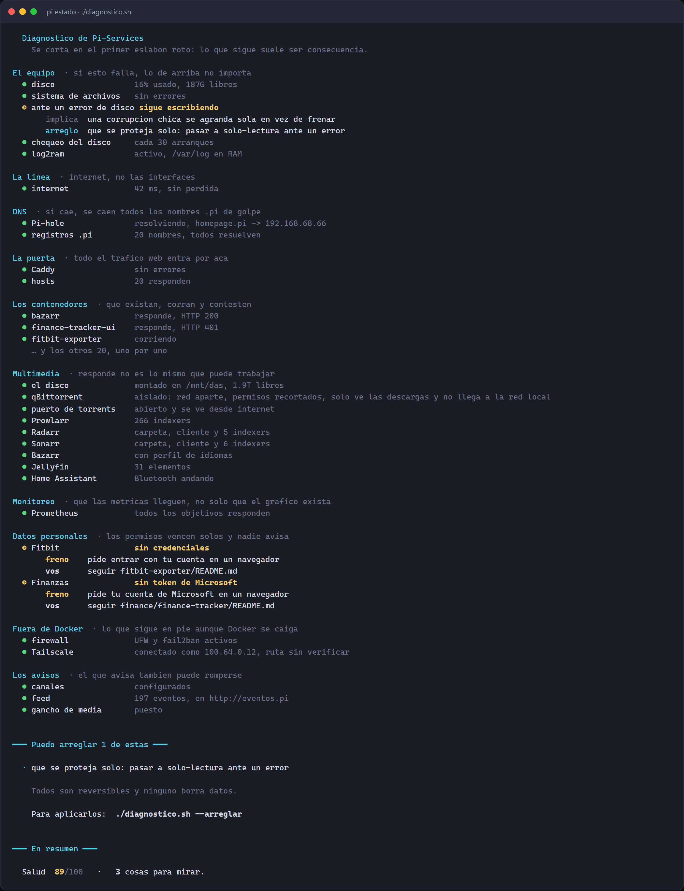
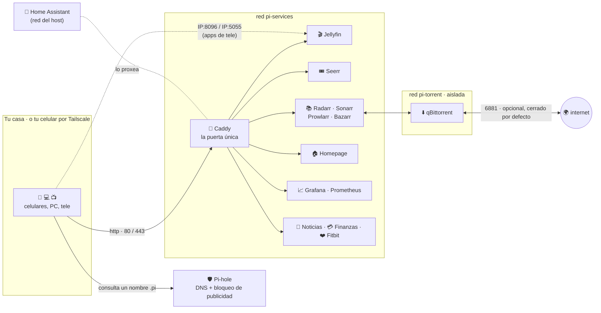

<div align="center">



<br>

[](docker-compose.yml) [](instalador.sh) [](#-qué-hay-adentro) [](media/README.md) [](home/README.md) [](TAILSCALE.md)

**[Qué es](#-qué-es) · [Capturas](#-capturas) · [Empezar](#-empezar) · [Qué hay adentro](#-qué-hay-adentro) · [Cómo está armado](#-cómo-está-armado) · [Seguridad](#-seguridad) · [Documentación](#-documentación)**

</div>

<br>

<p align="center">
  
  <br>
  <sub>El panel de inicio (Homepage): cada recuadro muestra datos en vivo del servicio que representa.</sub>
</p>

---

## ✨ Qué es

Un stack **autoalojado** para tener en casa, en una mini PC (o una Raspberry Pi), lo que normalmente alquilás a otros: bloqueo de publicidad para toda la red, tu propio Netflix con descargas automáticas, domótica, lector de noticias, control de gastos y datos de salud. **24 contenedores** Docker, más Pi-hole y Tailscale directo en el sistema.

Hoy corre en una mini PC Intel N95 con Ubuntu Server. Todo está en español y pensado para que lo pueda levantar alguien que no sea experto.

|  |  |
|---|---|
| 🧙 **Un instalador que configura** | No se limita a levantar contenedores: deja a Jellyfin con tu usuario y sus bibliotecas, a Radarr y Sonarr hablando con qBittorrent, a Seerr listo para pedir una película con un botón, e incluso te crea las cuentas. Todo antes de que abras el navegador. |
| 🔁 **Repetible** | Podés volver a correrlo cuando quieras: detecta lo que ya funciona y no lo toca. Rearmar la máquina desde cero es volver a correr un script. |
| 🩺 **Un diagnóstico que explica** | `pi estado` no dice "falló": dice qué, por qué importa, y si puede lo arregla (`--arreglar`). Y te avisa al celular solo cuando algo cambia. |
| 🔒 **Seguro por defecto** | Nada publicado a internet, todo entra por una sola puerta, y el único servicio que acepta datos de desconocidos (qBittorrent) vive encerrado en su propia red. |
| 📖 **Documentado con el porqué** | Cada decisión rara tiene escrito por qué se tomó y qué pasó cuando no se hizo así. |

---

## 📸 Capturas

> [!NOTE]
> Los datos de **Finanzas** y **Fitbit** de estas capturas son **inventados**, y Jellyfin y Sonarr se ven sobre una biblioteca de demostración (películas de dominio público y archivos de prueba). El resto es el sistema real funcionando.

### Lo que usás todos los días

<table>
  <tr>
    <td width="50%" align="center">
      <a href="docs/img/jellyfin.jpg"></a>
      <br><b>Jellyfin</b> · tu biblioteca, con carátulas y metadatos
    </td>
    <td width="50%" align="center">
      <a href="docs/img/sonarr-serie.jpg"></a>
      <br><b>Sonarr</b> · las series que seguís, temporada por temporada
    </td>
  </tr>
  <tr>
    <td colspan="2" align="center">
      <a href="docs/img/sonarr-series.jpg"></a>
      <br><b>Sonarr</b> · lo que ya tenés, lo que falta y lo que está por salir
    </td>
  </tr>
</table>

### Los números, en tableros

<table>
  <tr>
    <td width="50%" align="center">
      <a href="docs/img/grafana-pi.png"></a>
      <br><b>Salud del equipo</b> · CPU, temperatura, discos y latencia a internet
    </td>
    <td width="50%" align="center">
      <a href="docs/img/grafana-finanzas.png"></a>
      <br><b>Finanzas</b> · en qué se va la plata, mes a mes <sub>(datos de ejemplo)</sub>
    </td>
  </tr>
  <tr>
    <td width="50%" align="center">
      <a href="docs/img/grafana-fitbit.png"></a>
      <br><b>Salud personal</b> · pasos, sueño y ritmo cardíaco <sub>(datos de ejemplo)</sub>
    </td>
    <td width="50%" align="center">
      <a href="docs/img/finanzas-ui.png"></a>
      <br><b>Finance Tracker</b> · lee los mails del banco y arma tus movimientos <sub>(datos de ejemplo)</sub>
    </td>
  </tr>
</table>

<details>
<summary><b>Ver la pantalla de ingesta de Fitbit</b></summary>
<br>
<p align="center"></p>
</details>

### Cómo se ve el instalador

El instalador mira el estado real del equipo, te muestra qué está funcionando y qué falta, y te deja elegir. Para lo que implica un riesgo, **te lo explica antes de preguntar**: acá, si abrís o no el puerto de torrents. Hacé clic en cualquier captura para verla a tamaño completo.

<p align="center">
  <a href="docs/img/instalador-puerto.png"></a>
  <br><b>Una decisión de seguridad</b>, explicada antes de preguntar: qué ganás, qué arriesgás y qué queda hecho de todos modos. <a href="docs/TORRENTS.md">Más detalle</a>
</p>

<p align="center">
  <a href="docs/img/instalador-menu.png"></a>
  <br><b>El menú</b>: qué anda, qué falta y qué querés instalar. <a href="docs/INSTALADOR.md">Cómo funciona por dentro</a>
</p>

<details>
<summary><b><code>pi estado</code> · el diagnóstico que explica lo que encuentra</b></summary>
<br>
<p align="center">
  <a href="docs/img/diagnostico.png"></a>
  <br>Qué anda, qué no, por qué importa y cómo arreglarlo. <a href="docs/DIAGNOSTICO.md">Qué revisa y cómo leerlo</a>
</p>
</details>

---

## 🚀 Empezar

```bash
git clone git@github.com:Jerolussich/Pi-Services.git ~/pi-services
cd ~/pi-services && ./instalador.sh
```

El instalador te muestra el estado de cada módulo, te deja elegir cuáles querés (y hasta qué servicios sueltos dentro de cada uno), te pide solo los datos que no puede deducir, y levanta todo.

**Y no se queda en levantar contenedores: los configura.** Deja a Jellyfin con tu usuario y sus bibliotecas, a Radarr y Sonarr apuntando a sus carpetas y hablando con qBittorrent, a Seerr listo para pedir una película con un botón, y hasta te crea las cuentas de FreshRSS y Wallabag con sus claves de API escritas. Todo antes de que abras el navegador.

Podés volver a correrlo cuando quieras: detecta lo que ya funciona y no lo toca.

| | |
|---|---|
| **Cómo funciona por dentro** | [docs/INSTALADOR.md](docs/INSTALADOR.md) |
| **Índice de todo lo demás** | [docs/INDICE.md](docs/INDICE.md) |

---

## 🧩 Qué hay adentro

Todo entra por Caddy en `http://<nombre>.pi` (puertos 80 y 443). Las únicas excepciones son Jellyfin (8096 y 7359/udp) y Seerr (5055), que tienen login propio y se publican porque las apps de tele conectan por IP, y el puerto de torrents de qBittorrent, que viene cerrado (ver [TORRENTS.md](docs/TORRENTS.md)). La tabla completa, en [ARQUITECTURA.md](docs/ARQUITECTURA.md#los-puertos-publicados).

### 🎬 Multimedia

| Servicio | URL | Qué hace |
|---|---|---|
| Jellyfin | `jellyfin.pi` | Reproduce películas y series |
| Seerr | `seerr.pi` | Pedir contenido: buscás, apretás un botón y aparece |
| Radarr | `radarr.pi` | Automatiza películas |
| Sonarr | `sonarr.pi` | Automatiza series, con temporadas y calendario |
| Prowlarr | `prowlarr.pi` | Gestor central de indexers |
| Bazarr | `bazarr.pi` | Subtítulos automáticos |
| Recyclarr | interno | Elige el mejor release según la guía de TRaSH, y se actualiza solo. Sin interfaz |
| qBittorrent | `qbit.pi` | Cliente de descargas |
| FlareSolverr | interno | Resuelve el Cloudflare de los indexers que lo usan. Sin interfaz: solo le habla Prowlarr |

El contenido vive en un DAS de dos discos unidos con mergerfs. Detalle en [media/README.md](media/README.md) y [media/DAS.md](media/DAS.md).

### 🏠 Casa

| Servicio | URL | Qué hace |
|---|---|---|
| Home Assistant | `casa.pi` | Automatizar luces, sensores y enchufes. Con Bluetooth listo si el equipo tiene adaptador |

Es el único contenedor en la red del host, porque descubre dispositivos por mDNS y SSDP. Por qué eso no rompe la arquitectura, en [home/README.md](home/README.md).

### 🌐 Red y panel

| Servicio | URL | Qué hace |
|---|---|---|
| Pi-hole | `pihole.pi` | DNS de la red, bloqueo de publicidad, resuelve los `*.pi` |
| Caddy | interno | Proxy inverso: todo el tráfico HTTP entra por acá |
| Homepage | `homepage.pi` | Panel de inicio, con datos en vivo de cada servicio |
| Eventos | `eventos.pi` | Feed de lo que fue pasando. Sin servicio detrás: un archivo estático |
| Tailscale | interno | Acceso remoto sin abrir puertos en el router |

### 📈 Monitoreo

| Servicio | URL | Qué hace |
|---|---|---|
| Grafana | `grafana.pi` | Tableros de métricas, salud y finanzas |
| Prometheus | `prometheus.pi` | Recolección y almacenamiento de métricas |

Más Node Exporter y Pi-hole Exporter, sin interfaz propia. Ver [monitoring/README.md](monitoring/README.md).

### 📰 Lectura

| Servicio | URL | Qué hace |
|---|---|---|
| FreshRSS | `freshrss.pi` | Lector de RSS |
| Wallabag | `wallabag.pi` | Guardar artículos para leer después |
| News Filter | `news.pi` | Filtra noticias por palabras clave y guarda las que importan |

Ver [news/README.md](news/README.md).

### 💳 Datos personales

| Servicio | URL | Qué hace |
|---|---|---|
| Fitbit Exporter | `fitbit.pi` | Baja tus datos de salud de Fitbit |
| Finance Tracker | `finance.pi` | Lee los mails del banco y arma tus finanzas |

Ver [fitbit-exporter/README.md](fitbit-exporter/README.md) y [finance/finance-tracker/README.md](finance/finance-tracker/README.md).

### 🕐 Infraestructura

**Ofelia** ([ofelia/README.md](ofelia/README.md)) es el único programador de tareas *de los contenedores*: dispara trabajos adentro de los demás según etiquetas, en vez de que cada uno traiga su propio cron. Lo que corre en el host (diagnóstico, respaldo, avisos de media) va por timers de systemd.

---

## 🧱 Cómo está armado



Tres decisiones explican casi todo, y están desarrolladas en [docs/ARQUITECTURA.md](docs/ARQUITECTURA.md):

**Nada se expone directamente.** Casi ningún contenedor publica puertos: todo el HTTP entra por Caddy en el 80 y se reparte por nombre. Un solo lugar donde mirar quién entra y donde poner autenticación. Las excepciones son pocas, están a la vista y tienen su porqué (Jellyfin, Seerr y el puerto de torrents, cerrado por defecto).

**Los nombres los resuelve Pi-hole.** Cada servicio tiene su `*.pi`. Por eso Pi-hole no es solo un bloqueador: es de lo que depende que funcionen los nombres de toda la infraestructura.

**Un solo compose levanta todo.** El `docker-compose.yml` de la raíz no define servicios: los incluye desde cada carpeta. Un `docker compose up -d` levanta los 24, y `cd media && docker compose up -d` levanta solo ese módulo.

### Y se mantiene solo

Cada dato vive en un solo lugar y el resto se deriva. Los registros DNS de Pi-hole, el puerto interno de cada servicio y los puertos que hay que abrirle a Caddy en el firewall **salen todos del Caddyfile**. Agregar un servicio es agregar su bloque ahí; lo demás se acomoda la próxima vez que corras el instalador.

Las API keys tampoco se copian: el instalador las lee de cada servicio y las escribe donde hacen falta.

Y lo mismo con el tiempo: **los horarios de las tareas automáticas salen de [`ajustes.conf`](ajustes.conf)**, no de las unidades de systemd. Cambiás una línea ahí, volvés a correr el instalador, y las unidades se reescriben solas.

---

## 🔐 Seguridad

Es un despliegue de red local, con defensa en capas y **nada publicado a internet por defecto**: el router no tiene un solo puerto abierto hacia el equipo. La única cosa que podés abrir es el puerto de torrents de qBittorrent, y el instalador te pregunta antes, explicando qué ganás y qué arriesgás.

| Capa | Qué hace |
|---|---|
| **Caddy** | Punto único de entrada HTTP, con autenticación básica para los servicios que no traen la suya |
| **UFW** | Deja entrar 22, 80 y 53 (y el 443 si hay HTTPS). Los puertos del host (8181, 8123) quedan cerrados salvo para Caddy. Ojo: lo que Docker publica por su cuenta (8096, 7359/udp, 5055) no pasa por UFW |
| **fail2ban** | Banea una hora tras 5 intentos fallidos, en SSH y en la autenticación de Caddy |
| **Tailscale** | Acceso remoto sin abrir puertos |
| **Red `pi-torrent`** | qBittorrent, el único que acepta datos de desconocidos, va en una red aparte, sin privilegios, con solo la carpeta de descargas montada y sin acceso a la máquina, al router ni a la red local |

> [!TIP]
> **¿Abrir el puerto de torrents?** Viene cerrado, y descargar funciona igual. Abrirlo sirve para sembrar y ayuda sobre todo a los demás; a cambio, expone qBittorrent a internet. El instalador lo explica en pantalla y `pi puerto` lo cambia cuando quieras. Toda la evaluación —qué puede y qué no puede hacer alguien que lo ataque— está en [docs/TORRENTS.md](docs/TORRENTS.md).

```bash
./setup-security.sh --dry-run    # muestra todo lo que haria, sin hacer nada
./setup-security.sh              # lo aplica
```

Detecta los puertos de los servicios que estén corriendo, ofrece desactivar lo que no usás (VNC, rpcbind), y configura UFW y fail2ban. Tu LAN y tu tailnet quedan exentas del baneo, porque si no el que termina afuera sos vos.

### Archivos sensibles

Nunca se commitean, y están en `.gitignore`. Son también **lo primero que hay que respaldar**, porque son lo único que no se puede volver a generar:

- todos los `**/.env` — contraseñas de los servicios
- `caddy/.env` — el hash bcrypt de la autenticación básica
- `fitbit-exporter/tokens.json` — credenciales de OAuth de Fitbit
- `finance/finance-tracker/data/token.json` y `config.json` — tokens de Microsoft y el secreto de Azure

---

## 🔄 Lo que corre solo

Tres cosas pasan sin que las pidas, y están acá porque son justo las que uno olvida que existen hasta que las necesita.

| | Qué | Cuándo |
|---|---|---|
| **Feed** | lo que no merece interrumpirte pero sí recordarse, en `eventos.pi` | siempre |
| **Respaldo** | [`respaldo.sh`](respaldo.sh) guarda los `.env`, los tokens y todas las bases de datos en `~/respaldos` | todos los días a las 04:00 |
| **Diagnóstico** | [`diagnostico.sh`](diagnostico.sh) revisa todo, avisa, anota y publica métricas a Grafana. Ver [docs/DIAGNOSTICO.md](docs/DIAGNOSTICO.md) | cada hora |

Los timers los instala y los programa el instalador, desde [`systemd/`](systemd/). Además de esos tres, según lo que hayas elegido, deja otros: `pi-media` (agrupa los avisos de importaciones, solo con avisos), `pi-cert` (renueva el HTTPS, solo con HTTPS), `pi-upnp` (renueva el permiso del puerto de torrents, solo con UPnP) y `pi-torrent-red`, una tarea de arranque que vuelve a poner las reglas que aíslan a qBittorrent. **Los horarios y los umbrales se cambian en un solo archivo**, [`ajustes.conf`](ajustes.conf), y no adentro de las unidades ni del código.

**Una que NO se hace sola: el límite a los logs.** [`docker/daemon.json`](docker/README.md) acota los logs de Docker, que de fábrica no tienen tope y pueden llenar el disco, pero el instalador no lo copia: hay que ponerlo a mano (los dos comandos están en [docker/README.md](docker/README.md)).

### Y una que sí elegís

**Avisos al celular.** Es un módulo del menú del instalador, no algo que pasa solo, porque es lo único de todo el repo que manda algo fuera de tu casa: los títulos de los avisos pasan por ntfy.sh, un servicio público gratuito.

Si lo activás, cada hora el diagnóstico revisa todo y **te avisa solo si algo cambió de estado**. Si no cambió nada, silencio. Y el instalador te deja los pasos para suscribirte, con los nombres a la vista.

```bash
./avisos.sh --canales     # los pasos, con tus nombres
./avisos.sh --probar      # una prueba a cada canal
./avisos.sh --apagar      # dejar de recibirlos, sin borrar los canales
./avisos.sh               # el feed de eventos
```

El detalle, en [docs/AVISOS.md](docs/AVISOS.md).

> [!IMPORTANT]
> **Falta un paso que es tuyo:** bajarte una copia del respaldo. Mientras viva en el mismo disco, no es un respaldo.
> ```bash
> scp jlussich@192.168.68.66:~/respaldos/pi-respaldo-*.tar.gz .
> ```

---

## 🧰 Uso diario

Después de un reinicio **no hay nada que hacer**: Pi-hole y Tailscale son servicios del sistema, y los contenedores tienen `restart: unless-stopped`.

| Acción | Comando |
|---|---|
| Levantar todo | `docker compose up -d` |
| Bajar todo | `docker compose down` |
| Recrear un servicio | `docker compose up -d --force-recreate <servicio>` |
| Reconstruir tras cambiar código | `docker compose up -d --build <servicio>` |
| Ver el estado | `docker compose ps` |
| Ver qué anda mal y por qué | `pi estado` |
| Abrir o cerrar el puerto de torrents | `pi puerto` |
| Configurar las apps del celular | `pi movil` |
| Ver qué hay de nuevo para actualizar | `pi actualizar --ver` |

### Un solo comando

`pi` engloba todo y funciona desde cualquier carpeta, sin tener que entrar al repo:

```bash
pi              # cómo está la casa, y qué podés hacer
pi ayuda        # el resto de los subcomandos
```

No duplica lógica: elige el script de siempre y le pasa los argumentos tal cual. `pi avisos --probar` **es** `./avisos.sh --probar`. Lo instala el instalador como enlace en `/usr/local/bin`, así un `git pull` actualiza también el comando.

El detalle está en [docs/OPERACION.md](docs/OPERACION.md).

### Desde el celular

`./movil.sh` te ofrece solo las apps que sirven para lo que tenés **corriendo**, de a una, y te muestra los datos ya resueltos: cada clave sale de donde la guarda su servicio, sin que tengas que ir a buscarla. Después pregunta si te quedó funcionando y lo anota, así la próxima vez no te vuelve a ofrecer lo que ya tenés. El instalador ofrece esto mismo al terminar.

Todas las direcciones que te da van por Caddy, con el nombre `.pi` y sin puerto. La IP con el puerto interno del servicio es lo que dicen los tutoriales y lo que **no** funciona acá, porque esos puertos están cerrados a la red de casa a propósito. Las excepciones son Jellyfin (`IP:8096`) y Seerr (`IP:5055`), que sí se publican para las apps de tele.

El detalle está en [docs/INDICE.md](docs/INDICE.md#desde-el-celular).

---

## 📁 Estructura

<details>
<summary><b>Ver el árbol de carpetas</b></summary>

```
pi-services/
├── instalador.sh              ← levanta y configura, por modulos
├── diagnostico.sh             ← que anda, que no, y por que
├── avisos.sh                  ← el feed de eventos y los avisos al celular
├── movil.sh                   ← las apps del celular, con sus datos
├── actualizar.sh              ← que hay de nuevo, y actualizarlo con criterio
├── respaldo.sh                ← respaldo diario de lo irrecuperable
├── setup-security.sh          ← UFW y fail2ban
├── pi                         ← el comando que engloba todo lo de arriba
├── ajustes.conf               ← horarios y umbrales, el unico lugar donde se tocan
├── docker-compose.yml         ← incluye todos los servicios
├── lib/comun.sh               ← lo que el instalador y el diagnostico saben en comun
├── lib/avisos.sh              ← las cuatro salidas de un hallazgo
├── lib/movil.sh               ← el catalogo de apps y de donde sale cada clave
├── lib/jellyfin_plugins.sh    ← la seleccion de plugins y como se instalan
├── lib/actualizar.sh          ← comparar huellas contra lo publicado
├── lib/https.sh               ← el certificado de Tailscale y su renovacion
├── lib/discos.sh              ← preparar el disco del DAS: formatear, montar, mergerfs
├── lib/torrents.sh            ← el puerto de torrents: red aparte, firewall, UPnP y `pi puerto`
├── lib/indexers.sh            ← los indexers de Prowlarr que el instalador ofrece, explicados
├── lib/subtitulos.sh          ← los proveedores de subtitulos de Bazarr que el instalador ofrece
├── motd/                      ← el aviso al entrar por SSH, si hay algo mal
├── systemd/                   ← los timers y tareas de arranque (pi-upnp solo si elegís UPnP; pi-torrent-red aísla a qBittorrent), que instala el instalador
├── docker/                    ← daemon.json, el limite a los logs (se aplica a mano)
├── docs/                      ← toda la documentacion transversal (y las capturas en docs/img)
├── datos/                     ← se genera sola, no se versiona: feed, estado de los avisos, metricas lentas
│
├── caddy/                     ← proxy inverso, la puerta de entrada
├── homepage/                  ← panel de inicio
├── monitoring/                ← Prometheus, Grafana y exporters
├── media/                     ← Jellyfin, Seerr, Radarr, Sonarr, Prowlarr, Bazarr, qBittorrent
├── home/                      ← Home Assistant
├── news/                      ← FreshRSS, Wallabag, news-filter
├── finance/                   ← lector de mails del banco
├── fitbit-exporter/           ← datos de salud
├── ofelia/                    ← programador de tareas
└── calibre/                   ← DESINSTALADO, queda como referencia
```

</details>

Cada carpeta de servicio sigue el mismo patrón: `docker-compose.yml`, un `.env` que nunca se versiona, un `.env.example` como plantilla, y un `README.md` que explica qué hace y cómo configurarlo.

---

## 📚 Documentación

| Tema | Documento |
|---|---|
| Índice de todo | [docs/INDICE.md](docs/INDICE.md) |
| Cómo funciona el instalador | [docs/INSTALADOR.md](docs/INSTALADOR.md) |
| Decisiones de diseño y por qué | [docs/ARQUITECTURA.md](docs/ARQUITECTURA.md) |
| Levantar, bajar, actualizar, logs | [docs/OPERACION.md](docs/OPERACION.md) |
| El puerto de torrents: abrirlo o no, y qué pasa si lo atacan | [docs/TORRENTS.md](docs/TORRENTS.md) |
| Avisos al celular, feed y métricas | [docs/AVISOS.md](docs/AVISOS.md) |
| Qué revisa el diagnóstico y cómo leerlo | [docs/DIAGNOSTICO.md](docs/DIAGNOSTICO.md) |
| Salud del equipo y el disco | [docs/MANTENIMIENTO.md](docs/MANTENIMIENTO.md) |
| Acceso remoto | [TAILSCALE.md](TAILSCALE.md) |
| Qué pasó el 20 de agosto de 2026 | [docs/INCIDENTE-2026-08-20.md](docs/INCIDENTE-2026-08-20.md) |

Y cada servicio tiene el suyo, con el detalle técnico y los problemas conocidos.
