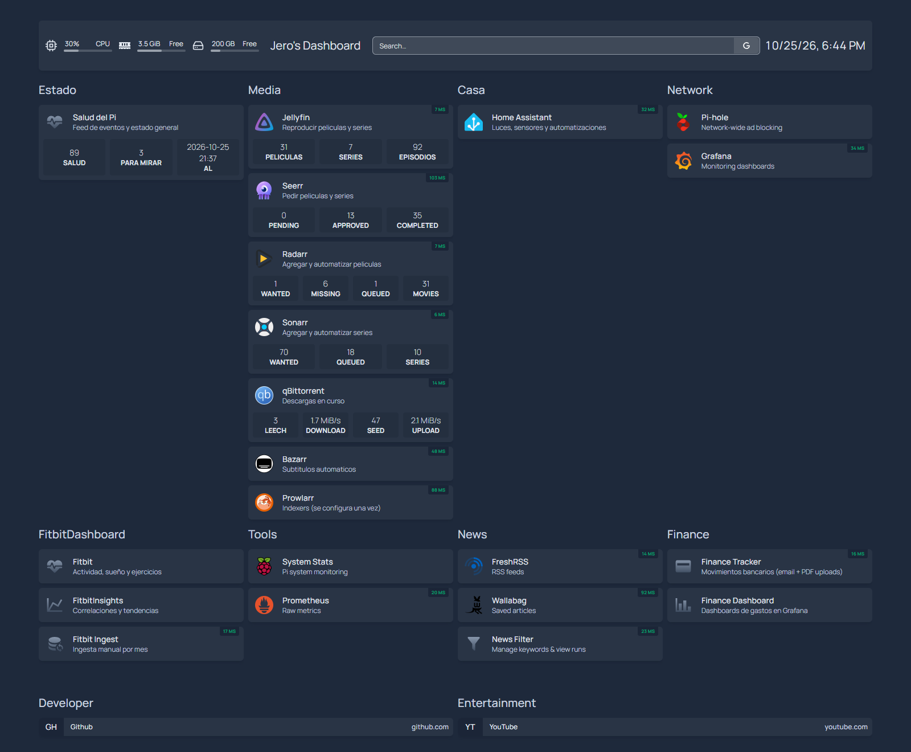

# Homepage

Dashboard unificado para todos los servicios del Pi. Corre como contenedor Docker y sirve como punto de entrada visual a toda la infraestructura.

<p align="center">
  
  <br><sub>El panel de inicio, con datos en vivo de cada servicio</sub>
</p>

---

## Arquitectura

```
homepage/
├── docker-compose.yml
├── .env                  ← gitignored
├── .env.example
└── config/               ← Bind-mounted en el contenedor
    ├── services.yaml     ← Links a los servicios
    ├── settings.yaml     ← Configuración general
    ├── widgets.yaml      ← Widgets del dashboard
    ├── bookmarks.yaml    ← Bookmarks externos
    ├── docker.yaml       ← Integración Docker (opcional)
    ├── kubernetes.yaml   ← Integración K8s (opcional)
    ├── proxmox.yaml      ← Integración Proxmox (opcional, sin usar)
    └── custom.css / custom.js   ← vacíos, para retoques propios
```

---

## Setup

### 1. Configurar el .env

```bash
cp .env.example .env
```

Editar `.env`:

```
PI_IP=your_pi_ip
```

### 2. Levantar el contenedor

Desde la raíz del repo:

```bash
docker compose up -d homepage
```

O solo este servicio desde su carpeta:

```bash
cd homepage
docker compose up -d
```

### 3. Verificar

```bash
docker logs homepage
```

Acceder en: `http://homepage.pi`, con el usuario y la contraseña que le pusiste a Caddy.

---

## Configuración

Todos los archivos de config están en `config/` y son bind-mounted al contenedor. Cualquier cambio que hagas en los archivos se refleja automáticamente sin necesidad de reiniciar el contenedor.

### services.yaml
Define los links a los servicios organizados por grupo. Estructura actual:

| Grupo | Servicios |
|---|---|
| Estado | Salud del Pi (el score del diagnóstico) |
| Media | Jellyfin, Seerr, Radarr, Sonarr, qBittorrent, Bazarr, Prowlarr, Recyclarr |
| Casa | Home Assistant |
| Network | Pi-hole, Grafana |
| FitbitDashboard | Fitbit, Fitbit Insights, Fitbit Ingest |
| Tools | System Stats, Prometheus |
| News | FreshRSS, Wallabag, News Filter |
| Finance | Finance Tracker, Finance Dashboard |

Para agregar un servicio nuevo:

```yaml
- MiGrupo:
    - MiServicio:
        icon: nombre-icono.png
        href: http://<pi_ip>:<puerto>
        description: Descripción corta
```

Los íconos disponibles se pueden buscar en [https://github.com/walkxcode/dashboard-icons](https://github.com/walkxcode/dashboard-icons). Para íconos MDI usar el prefijo `mdi-`, ejemplo: `mdi-heart-pulse`.

### settings.yaml
Configuración general del dashboard — tema, colores, hosts permitidos. Si cambiás la IP del Pi, actualizá `allowedHosts` acá y `PI_IP` en el `.env`.

### widgets.yaml
Widgets que aparecen en la barra superior:

| Widget | Descripción |
|---|---|
| `search` | Buscador Google |
| `datetime` | Fecha y hora |
| `resources` | CPU, RAM y disco del Pi |
| `greeting` | Texto de bienvenida |

### bookmarks.yaml
Links externos agrupados por categoría. Actualmente: GitHub y YouTube.

---

## Los recuadros con datos en vivo

Algunos servicios no muestran solo un enlace sino **datos reales**: cuántas películas tenés en Radarr, qué se está bajando, cuántos pedidos hay en Seerr. Para eso el widget necesita la API key de ese servicio.

**El instalador las lee y las escribe solo.** Nunca las copiás ni las ves. Si alguna vez regenerás una, volvés a correr `./instalador.sh` y se actualiza.

| Variable | De dónde sale |
|---|---|
| `HOMEPAGE_VAR_RADARR_KEY` | la config de Radarr |
| `HOMEPAGE_VAR_SONARR_KEY` | la config de Sonarr |
| `HOMEPAGE_VAR_PROWLARR_KEY` | la config de Prowlarr |
| `HOMEPAGE_VAR_SEERR_KEY` | `settings.json` de Seerr |
| `HOMEPAGE_VAR_JELLYFIN_KEY` | una clave propia que el instalador crea en Jellyfin |
| `HOMEPAGE_VAR_QBIT_USER` y `_PASS` | la contraseña que el instalador le acaba de poner |

**Recyclarr no tiene interfaz ni puerto**, así que su recuadro no tiene puntito de "está vivo". Muestra lo que importa de él: cuántos formatos tienen Radarr y Sonarr, con dos `customapi` contra `/api/v3/customformat` y las mismas claves de Radarr y Sonarr. Si alguno muestra 1, es solo el `Upscaled` del instalador y Recyclarr no está llegando. El enlace lleva a `Settings → Custom Formats` de Radarr.

Jellyfin y qBittorrent traían recuadro nativo y estaban apagados: solo mostraban el puntito de "está vivo". Ahora qBittorrent muestra qué se está bajando, y Jellyfin cuántas películas, series y episodios hay.

**El de Jellyfin ya no es el recuadro nativo.** Con Jellyfin 12, `type: jellyfin` contestaba 404 y mostraba "API Error": la 12 sacó la ruta `/emby` y la clave en la URL, que el recuadro nativo usa (gethomepage/homepage#7113 sigue sin resolverse). Hoy es un `customapi` contra `/Items/Counts` con la cabecera `Authorization: MediaBrowser Token=...`, con la misma clave de siempre (`HOMEPAGE_VAR_JELLYFIN_KEY`). Se pierde el "quién está reproduciendo ahora". El detalle, en [../media/README.md](../media/README.md#jellyfin-12-lo-que-cambió-y-lo-que-se-rompió).

qBittorrent es el único que no tiene clave de API: se entra con usuario y contraseña. El instalador no te la vuelve a preguntar, reusa la que le acaba de poner.

### El recuadro de salud

El primero de la pantalla no viene de ningún servicio: es un JSON de tres campos que escribe `diagnostico.sh` cada hora y que sirve Caddy como archivo estático.

```yaml
widget:
  type: customapi
  url: http://caddy/estado.json
```

Va contra `caddy` y no contra `eventos.pi` porque la homepage lo pide desde adentro de la red de Docker, con ese nombre como Host. Es un número y un conteo, sin autenticación, y nada de esto está publicado a internet. Ver [../docs/AVISOS.md](../docs/AVISOS.md).

### El detalle que hace fallar todo esto

El `docker-compose.yml` **tiene que tener `env_file: - .env`**. Sin eso las claves quedan escritas en el `.env` sin entrar nunca al contenedor.

Es una confusión fácil: Compose lee el `.env` de al lado para sustituir variables **en el propio YAML**, como el `${PI_IP}`, pero eso no las mete adentro del contenedor. Y el síntoma no ayuda nada: los recuadros mandan la clave vacía, cada servicio contesta 401 o 403, y la homepage muestra **"API Error"** sin decir que el problema es que la clave nunca llegó.

Para comprobarlo:

```bash
docker exec homepage sh -c 'env | grep HOMEPAGE_VAR'
```

Si no lista nada, el problema es ese. El instalador ahora lo verifica ahí adentro y avisa si no llegaron.

### Home Assistant es la excepción

Su recuadro necesita un token que **solo existe después de que crees tu usuario**, así que el instalador no puede leerlo como los otros. Queda comentado en `services.yaml` con las instrucciones al lado; si lo querés, generás el token en tu perfil de Home Assistant y lo ponés como `HOMEPAGE_VAR_HA_TOKEN`.

---

## Variables de entorno

| Variable | Descripción | Ejemplo |
|---|---|---|
| `PI_IP` | IP del Pi en la red local | `192.168.68.66` |
| `HOMEPAGE_VAR_*_KEY` | API keys de los recuadros, las escribe el instalador | — |

`PI_IP` se usa para setear `HOMEPAGE_ALLOWED_HOSTS` — sin esto Homepage rechaza las conexiones con un error de host validation.

---

## Notas

- **No expone ningún puerto al host**: se entra por `http://homepage.pi`, que pasa por Caddy con su autenticación básica. Es el mismo trato que el resto del repo.
- Los archivos de config se editan directamente en el host, no hace falta entrar al contenedor
- Si agregás un servicio en `services.yaml`, el dashboard se actualiza al recargar el browser
- **Los cambios en el `.env` sí necesitan recrear el contenedor**, no alcanza con `restart`: `docker compose up -d --force-recreate homepage`
- `siteMonitor` es el puntito de arriba a la derecha de cada tarjeta. Ojo con las URLs que redirigen: la raíz de FreshRSS manda a `/i/?rid=<sesión>` y sin sesión corta la conexión, así que apunta al favicon. Pi-hole necesita la barra final en `/admin/` o su 308 rompe el parser HTTP.
- `docker.yaml` y `kubernetes.yaml` están incluidos pero vacíos — se pueden completar para mostrar el estado de los contenedores directamente en el dashboard
