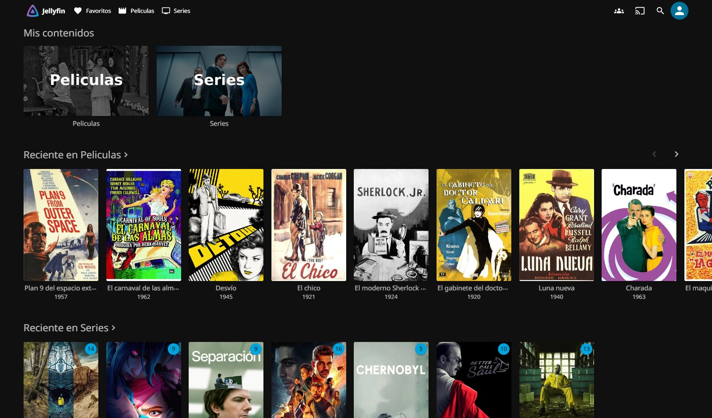
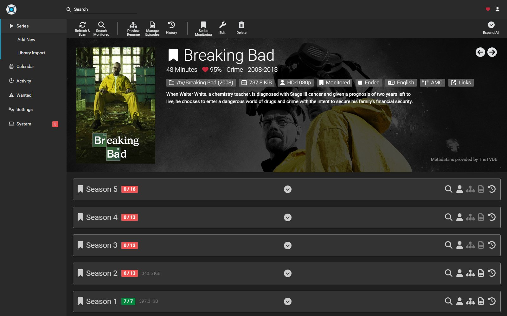
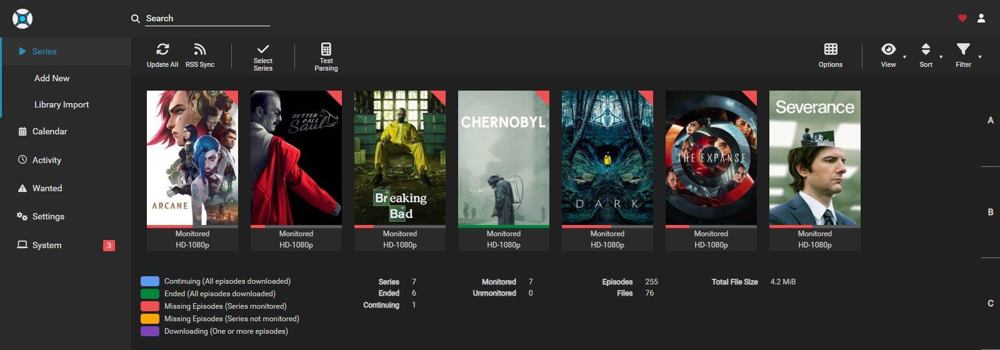

# Media

Stack multimedia del Pi. Descarga, organiza, subtitula y reproduce, con todo el contenido viviendo en un DAS de dos discos unidos.

<table>
  <tr>
    <td width="50%" align="center"><br><sub>Jellyfin: la biblioteca</sub></td>
    <td width="50%" align="center"><br><sub>Sonarr: una serie, temporada por temporada</sub></td>
  </tr>
</table>

<p align="center">
  
  <br><sub>Sonarr: la lista de series</sub>
</p>

<sub>Capturas sobre una biblioteca de demostración: películas de dominio público y archivos de prueba.</sub>

---

## Arquitectura

```
                          ┌──────────────┐
                          │    Seerr     │  vos pedis aca
                          └──────┬───────┘
                                 │ lo manda al que corresponde
                    ┌────────────┴────────────┐
                    ▼                         ▼
                    ┌──────────┐   ┌──────────┐
   Prowlarr ───────▶│  Radarr  │   │  Sonarr  │◀─────── Prowlarr
  (indexers)        │peliculas │   │  series  │        (los mismos)
                    └────┬─────┘   └─────┬────┘
                         │  envian el torrent │
                         └─────────┬─────────-┘
                                   ▼
                          ┌──────────────┐
                          │ qBittorrent  │  baja a /data/downloads
                          └──────┬───────┘
                                 │ hardlink, no copia
                    ┌────────────┴────────────┐
                    ▼                         ▼
           /data/media/movies         /data/media/tv
                    │                         │
                    └────────────┬────────────┘
                                 │
   Bazarr  ─────────────────────▶│  les engancha subtitulos
  (subtitulos)                   │
                                 ▼  solo lectura
                          ┌──────────────┐
                          │   Jellyfin   │  reproduce
                          └──────┬───────┘
                                 │
                          ┌──────┴───────┐
                          │  /mnt/das    │  mergerfs
                          └──┬────────┬──┘
                             │        │
                         /mnt/disk1  /mnt/disk2
```

**Radarr y Sonarr son el mismo motor con distinto contenido.** Misma API, mismos endpoints, misma forma de configurarse. Cambian la carpeta y poco más: Sonarr además entiende de temporadas, episodios y calendario de emisión, que es lo que justifica que sean dos y no uno.

Comparten indexers (los de Prowlarr), cliente de descargas (qBittorrent) y subtitulador (Bazarr). Lo único que no comparten es la carpeta de destino, y eso es lo que le permite a Jellyfin tener dos bibliotecas distintas.

Dos cosas sostienen todo el diseño:

**Una única raíz de almacenamiento.** Radarr, Sonarr y Bazarr montan el DAS entero en el mismo path `/data`. Eso permite que Radarr importe con **hardlinks** en vez de copiar, así una película ocupa espacio una sola vez aunque figure en descargas y en la biblioteca. (qBittorrent monta solo `/data/downloads`, con la misma ruta de adentro, y Jellyfin solo `/media`, de lectura: ninguno de los dos necesita ver todo.)

**Los dos discos se ven como uno.** `mergerfs` los une en `/mnt/das`, así Jellyfin escanea una sola biblioteca y no te importa en qué disco cayó cada archivo. Está todo en [DAS.md](DAS.md).

---

## Servicios

| Contenedor | Imagen | Puerto interno | Hostname | Descripción |
|---|---|---|---|---|
| `jellyfin` | `jellyfin/jellyfin` | `8096` | `jellyfin.pi` | Servidor multimedia y reproducción |
| `seerr` | `ghcr.io/seerr-team/seerr` | `5055` | `seerr.pi` | Pedir contenido: buscás y apretás un botón |
| `radarr` | `lscr.io/linuxserver/radarr` | `7878` | `radarr.pi` | Gestión y automatización de películas |
| `sonarr` | `lscr.io/linuxserver/sonarr` | `8989` | `sonarr.pi` | Lo mismo para series, con temporadas y calendario |
| `prowlarr` | `lscr.io/linuxserver/prowlarr` | `9696` | `prowlarr.pi` | Gestor central de indexers |
| `bazarr` | `lscr.io/linuxserver/bazarr` | `6767` | `bazarr.pi` | Descarga automática de subtítulos |
| `recyclarr` | `ghcr.io/recyclarr/recyclarr:8` | — | — | Mantiene la calidad de Radarr y Sonarr al día con la guía de TRaSH. Sin interfaz |
| `qbittorrent` | `lscr.io/linuxserver/qbittorrent` | `8080` | `qbit.pi` | Cliente de descargas |
| `flaresolverr` | `ghcr.io/flaresolverr/flaresolverr` | `8191` | — | Resuelve el Cloudflare de los indexers que lo usan |

Casi nada publica puertos al host: todo entra por Caddy, igual que el resto del repo. Las excepciones son Jellyfin (`8096` y `7359/udp`, el descubrimiento automático para que las apps encuentren el servidor sin tipear la IP) y Seerr (`5055`), porque las apps de tele se conectan por IP y no resuelven los nombres `.pi`; los dos tienen su propio login. Y la otra excepción es el puerto de torrenting de qBittorrent, que necesita aceptar conexiones entrantes de otros pares. **Viene cerrado** (escucha solo en `127.0.0.1`): abrirlo es opcional y lo decidís en el instalador o después con `pi puerto`. Qué ganás, qué implica y qué protecciones lleva puestas, en [../docs/TORRENTS.md](../docs/TORRENTS.md).

`flaresolverr` no tiene hostname porque no es para vos: no tiene interfaz que visitar. Solo le habla Prowlarr, por la red interna del compose, en `http://flaresolverr:8191`.

---

## Estructura

```
media/
├── docker-compose.yml
├── .env                    ← gitignored
├── .env.example
├── README.md
├── DAS.md                  ← los dos discos con mergerfs
├── recyclarr/
│   ├── recyclarr.yml       ← qué formatos de TRaSH se aplican, y por qué
│   └── .env                ← las API keys de Radarr y Sonarr, gitignored
└── JELLYFIN-PLUGINS.md     ← plugins, cuáles son nativos y cuáles no
```

---

## Puesta en marcha

### 1. El DAS primero

Seguí [DAS.md](DAS.md) completo. No sigas hasta que la prueba de hardlinks de ese documento pase: si falla, el stack duplica espacio en silencio y te enterás tarde.

### 2. Aceleración por hardware

Jellyfin decodifica por hardware a través de `/dev/dri`, y para eso el dispositivo tiene que ser legible. En una Pi puede pasar que **el grupo `render` no exista**, y entonces `/dev/dri/renderD128` queda como `root:root`: sin arreglarlo, Jellyfin no puede usar el decodificador. Se comprueba con `ls -la /dev/dri/renderD128`; si dice `root root`, esto lo resuelve:

```bash
getent group render || sudo groupadd -r render
```

```bash
sudo udevadm control --reload && sudo udevadm trigger --subsystem-match=drm
```

Comprobá que cambió de dueño:

```bash
ls -la /dev/dri/renderD128
```

Tiene que decir `root render`. Si sigue en `root root`, un reinicio lo resuelve.

### 3. Configuración

```bash
cp .env.example .env
```

Completá con tus valores reales:

```bash
id -u; id -g                              # PUID y PGID
```

### 4. Levantar

```bash
cd ~/pi-services && docker compose up -d
```

Sube junto con el resto del stack, con el mismo comando que todo lo demás.

**Ojo con esto:** el stack multimedia arranca aunque el DAS no esté montado. `DAS_ROOT` apunta a `/mnt/das`, y esa carpeta existe igual, así que los contenedores levantan, se ven sanos, y descargan a la tarjeta del sistema hasta llenarla.

Quien te protege de eso es el instalador, que comprueba si `/mnt/das` está en otro dispositivo que la raíz del sistema y, si no lo está, te ofrece configurar todo con las descargas en pausa. Si levantás a mano, esa comprobación no corre y quedás por tu cuenta. El diagnóstico igual lo sigue vigilando: si el DAS deja de estar montado, lo marca, y `./diagnostico.sh --arreglar` pone las descargas de qBittorrent en pausa hasta que vuelvas a conectar el disco.

---

## Configuración inicial

**Esto lo hace el instalador.** Corré `./instalador.sh`, elegí el módulo de multimedia, y deja los siete servicios configurados y hablando entre ellos. Lo que sigue está para que sepas qué quedó hecho, y para hacerlo a mano si alguna vez lo necesitás.

El orden importa, porque cada pieza se registra contra la anterior.

### 1. qBittorrent

La contraseña temporal se imprime en el log del primer arranque:

```bash
docker logs qbittorrent | grep -i password
```

Entrá a `http://qbit.pi`, cambiala, y configurá las rutas como `/data/downloads/incomplete` y `/data/downloads/complete`.

Dos cosas que hacen tropezar acá. La primera es que **viene apuntando a `/downloads`, que en este stack no existe**: la carpeta de descargas se ve en `/data/downloads`, la misma ruta que ven Radarr y Sonarr, así que sin corregirlo las descargas caen adentro del contenedor y se pierde el hardlink con la biblioteca. La segunda es que **no acepta contraseñas de menos de 6 caracteres**, y si la mandás por su API el error viene en el cuerpo de la respuesta, no en el código.

### 2. Prowlarr

En `http://prowlarr.pi`, agregá tus indexers (el instalador te ofrece de a uno una lista corta de siete, explicados: 1337x, The Pirate Bay, YTS, EZTV, Nyaa.si, Anime Tosho y SubsPlease; lo que no cargues ahí queda para acá). Después, en `Settings → Apps`, agregá Radarr con URL `http://radarr:7878` y Sonarr con `http://sonarr:8989`. Prowlarr les sincroniza los indexers solo, y no vas a tener que cargarlos de nuevo en cada aplicación.

Es el único lugar donde se cargan indexers. Ese es el punto de tener Prowlarr.

### 3. Radarr y Sonarr

Los dos igual, cambiando solo la carpeta:

| | Radarr | Sonarr |
|---|---|---|
| URL | `http://radarr.pi` | `http://sonarr.pi` |
| Carpeta raíz | `/data/media/movies` | `/data/media/tv` |

En los dos, `Settings → Media Management` para la carpeta raíz y para activar **`Use Hardlinks instead of Copy`**, y `Settings → Download Clients` para agregar qBittorrent con host `qbittorrent` y puerto `8080`.

**Validan la conexión al guardar**: si la contraseña de qBittorrent no es la correcta, no guardan nada y responden `Unable to connect to qBittorrent`.

Y no hace falta cargar los indexers acá: Prowlarr se los sincroniza a los dos.

### 4. Bazarr

En `http://bazarr.pi`, conectá Radarr con host `radarr` y puerto `7878`, y Sonarr con host `sonarr` y puerto `8989`.

El **perfil de idiomas** lo deja creado el instalador con Español e Inglés, y es más importante de lo que suena: sin uno, Bazarr corre, se ve sano, aparece conectado a Radarr y a Sonarr, y no baja un solo subtítulo nunca. Es el paso que más se olvida de todo el stack y el que peor avisa. Si querés otros idiomas, se cambia en `Settings → Languages`.

El instalador también te ofrece de a uno siete proveedores (OpenSubtitles.com, Subtitulamos.tv, Subtis, subtítulos embebidos, YifySubtitles, Subf2m y SubDL), y los que no piden cuenta quedan andando en el momento. Lo que queda para vos es **de dónde bajarlos** si no elegiste ninguno, en `Settings → Providers`. Los que andan bien sin pagar son OpenSubtitles.com, que pide crear cuenta propia, y Subdivx. Si no elegís ninguno, Bazarr corre pero nunca baja nada.

Un detalle por si lo hacés a mano: los perfiles **no se guardan por su propio endpoint**, que contesta `405`. Van por el de configuración general, con el perfil serializado adentro:

```bash
curl -X POST -H "X-API-KEY: $KEY" --data-urlencode "languages-profiles=$PERFIL" http://bazarr:6767/api/system/settings
```

### 5. Jellyfin

En `http://jellyfin.pi`, creá dos bibliotecas: una de **Películas** apuntando a `/media/movies` y otra de **Series** apuntando a `/media/tv`. Es importante que sean dos y con el tipo correcto, porque Jellyfin busca los metadatos de forma distinta para cada una. En `Dashboard → Playback`, activá aceleración por hardware con **VAAPI** y dispositivo `/dev/dri/renderD128`. El instalador lo hace por vos y **no supone qué sabe hacer el chip**: se lo pregunta (`vainfo`) y activa solo los códecs que decodifica, la codificación por hardware solo si existe y el tone mapping del HDR solo si hay OpenCL.

Una advertencia concreta sobre el Pi 5: **no tiene codificador de video por hardware**. Decodifica H.264 y HEVC por hardware, pero al codificar usa CPU. Por eso hay que dejar la codificación por hardware **apagada**: si la activás, cada transcodificación falla. En la práctica conviene reproducir en formato nativo y evitar transcodificar. Si tus clientes soportan el códec original, el Pi 5 alcanza de sobra.

### 6. Seerr

En `http://seerr.pi`, entrás con tu usuario de Jellyfin, habilitás las bibliotecas, y conectás Radarr y Sonarr. El instalador lo deja hecho entero.

**Va último a propósito.** Seerr no hace nada por sí mismo: para configurarse necesita que Jellyfin ya tenga sus bibliotecas y que Radarr y Sonarr ya existan con su carpeta raíz. Si lo configurás antes, guarda conexiones vacías.

Hay una parte de esto que **no es idempotente**, y conviene saberlo: el primer POST a `/api/v1/auth/jellyfin` crea el usuario dueño y no se puede repetir. Por eso el instalador comprueba antes si ya hay usuarios, y si los hay no lo toca.

### El perfil de calidad que mejora solo

Radarr y Sonarr quedan con un perfil llamado **Perfeccionista**, que es el que usan los pedidos de Seerr.

Hace dos cosas. La primera es **aceptar todas las calidades**, así una película rara que solo existe en 480p igual se baja en vez de no bajarse nunca. La segunda es **poner el corte arriba de todo** con la mejora automática activada: cuando el indexer encuentra una versión mejor de algo que ya tenés, la baja y reemplaza la anterior sola.

O sea que pedís una vez y la copia va mejorando con el tiempo, sin que vuelvas a mirarla.

Además el perfil lleva un formato personalizado, **Upscaled**, con puntaje `-10000`: rechaza los releases que dicen en el título que son reescalados con IA (`upscaled`, `AI`, `Topaz`), porque un "4K" reescalado es un 1080p agrandado. No atrapa uno que no lo declare.

Quedan afuera dos calidades a propósito: **BR-DISK** y **Raw-HD**, que son la imagen del disco entera sin comprimir. Pesan decenas de gigas, muchos reproductores no las abren, y en un Pi 5 obligan a transcodificar, que es justo lo que conviene evitar.

| | Radarr | Sonarr |
|---|---|---|
| Calidades aceptadas | 24 de 26 | 17 de 18 |
| Corte | Remux-2160p | Bluray-2160p Remux |
| Mejora automática | sí | sí |

**Ojo con el espacio.** Este perfil pide lo mejor que exista, y lo mejor que existe pesa: un remux 2160p son entre 40 y 80 GB. Con la mejora automática además baja de nuevo lo que ya tenías. Si estás corto de disco, en `Settings → Profiles` bajá el corte a `Bluray-1080p` y la cosa se vuelve mucho más razonable.

### Recyclarr: la guía de TRaSH aplicada sola

El perfil Perfeccionista decide **qué calidades** se aceptan. Lo que no decidía era **cuál de los releases** de una misma calidad conviene: dos "2160p Remux" pueden ser uno impecable de un grupo serio y otro mal hecho, y para Radarr eran iguales.

[TRaSH](https://trash-guides.info) es la guía que la comunidad de los *arr mantiene sobre eso: qué grupos encodean bien, cuáles tienen historial de releases malos, qué es un HDR de verdad. Recyclarr la lee una vez por día, a las 5 (después del respaldo de las 4), y le aplica al perfil Perfeccionista lo que dice [recyclarr/recyclarr.yml](recyclarr/recyclarr.yml). Si la comunidad descubre un grupo malo nuevo, llega solo.

**Qué hace con el perfil:**

- **Descarta** (−10000) los releases de grupos de baja calidad (`LQ`), la imagen de disco entera (`BR-DISK`), los extras, el 3D, el HDR dinámico inventado y el **Dolby Vision sin HDR10 de respaldo**, que en una tele sin Dolby Vision se ve con colores violetas o verdes.
- **Prefiere**, dentro de una misma calidad, los grupos que la guía tiene en sus listas de calidad (Remux, UHD Bluray, HD Bluray y WEB, en tres niveles), los HDR reales y las correcciones (`REPACK`/`PROPER`).

**Qué no toca, a propósito:**

- Las calidades aceptadas ni la mejora automática del perfil: siguen como las deja el instalador. Radarr decide primero por calidad y después por puntaje, así que esto no cambia qué tan grande es lo que se baja.
- El formato `Upscaled` del instalador. La guía tiene uno con el mismo nombre, y Recyclarr pisa cualquier formato que se llame igual; el nuestro atrapa también "AI" y "Topaz", así que el de la guía queda afuera.
- Los tamaños mínimos por calidad de la guía. Rechazarían un Bluray-1080p de menos de ~6 GB para dos horas, o sea los buenos encodes x265, que para una película rara pueden ser lo único que existe. Se vio con una prueba en seco antes de decidirlo.
- Los otros perfiles (`Any`, `HD-1080p`, etc.): reciben los formatos nuevos con puntaje 0, que es lo que hace Radarr con todo perfil cuando se crea un formato, y nada más.

**Lo que ya está descargado no se reemplaza por un grupo mejor.** Al aplicarlo, 11 de 31 películas y 8 episodios quedaron marcados como de grupos `LQ` (FGT, BTM, AOC, YIFY y reescalados), y Radarr salió a buscarles reemplazo de la misma calidad: para *Inception*, *I Am Legend* y *El Padrino III* tenía candidatos aprobados, y a *Hang 'em High* le iba a cambiar un HDR por un SDR a 60 cuadros interpolados. Para que eso no pase, el perfil exige que, para mejorar **sin subir de calidad**, el puntaje nuevo supere al actual por 100000 (`min_upgrade_format_score`), algo que nunca ocurre. Se verificó preguntándole a Radarr qué bajaría: los mismos candidatos pasaron a rechazados con *"Existing file on disk has Custom Format score within Custom Format score increment"*.

Lo que **sí** sigue: la mejora por calidad (un 1080p que pasa a 2160p cuando aparece), que es como funcionaba el perfil desde antes, y los `REPACK`/`PROPER` del mismo release. Y la guía sigue eligiendo el mejor release para todo lo que se baje de acá en adelante.

```bash
docker exec recyclarr recyclarr sync --preview   # qué cambiaría, sin aplicar nada
docker exec recyclarr recyclarr sync             # aplicarlo ahora
docker logs recyclarr                            # cómo salió la última
```

El diagnóstico lo controla leyendo el perfil (si no tiene los formatos de la guía, o si la última sincronización dio errores, lo dice y lo arregla con `--arreglar`). Las API keys las escribe el instalador en `recyclarr/.env`, aparte de `.env` para que no las cargue qBittorrent. Antes de la primera sincronización se guardó una copia de los perfiles en `~/respaldos/antes-recyclarr/`.

### Con varios indexers, ¿cuál se usa?

Los cuatro. La pregunta natural es "cuál elige", pero el modelo mental correcto es otro: **Radarr no elige un indexer, elige un release.** El indexer es nada más de dónde salió cada candidato.

Cuando pedís algo, Radarr le pregunta **en paralelo a todos los que tenga habilitados**, junta los resultados de todos en una sola lista, los puntúa y se queda con el mejor. Seerr no participa de esta decisión: él solo entrega el pedido y se olvida. Nunca ve un indexer.

Qué pesa, en orden:

**1. El perfil de calidad, que manda sobre todo lo demás.** Cualquier release cuya calidad no esté aceptada en el perfil se descarta sin más análisis. Entre los que pasan, gana el que esté más arriba en el orden del perfil. Por eso un indexer que publica x265 comprimido —YTS es el caso típico— casi nunca gana aunque conteste primero: su calidad queda abajo en la escala. Sirve de red para cuando no hay nada mejor.

**2. Tamaño y seeders.** El release tiene que entrar en los límites de tamaño de esa calidad, y superar el mínimo de seeders configurado para su indexer.

**3. La prioridad del indexer, y solo para desempatar.** Todos arrancan en **25**, el valor por defecto. Ese número entra en juego únicamente cuando dos releases son equivalentes en todo lo anterior: misma calidad, tamaño parecido. Ahí gana el del número más bajo.

Si querés que ante un empate prefiera uno sobre otro —razonable, por ejemplo, entre un indexer con metadatos limpios y otro con metadatos sucios— se cambia **en Prowlarr**, en el indexer, y se sincroniza solo a Radarr y Sonarr. No hay que tocarlos a ellos.

**Más indexers no es más rápido ni mejor.** Es más candidatos para elegir el mismo ganador. Lo que mejora de verdad es la probabilidad de encontrar algo raro que los otros no tengan. El costo es que cada búsqueda espera a que contesten todos, así que a partir del quinto o sexto sumás latencia sin ganar casi nada.

### Indexers detrás de Cloudflare

Varios —1337x, TorrentGalaxy, DonTorrent— están protegidos por Cloudflare y Prowlarr no los puede consultar solo: la búsqueda falla con `blocked by CloudFlare Protection` aunque el indexer esté perfectamente configurado. El error no dice que falte nada, así que parece que el indexer está roto.

Para eso está el contenedor **FlareSolverr**, que resuelve el desafío con un navegador headless. El instalador lo levanta y lo da de alta en Prowlarr solo.

Hay un detalle que cuesta descubrir: **el proxy solo se aplica a los indexers que llevan su misma etiqueta.** Dar de alta FlareSolverr no alcanza; hay que ponerle la etiqueta `flaresolverr` a cada indexer que lo necesite, en su campo Tags. Un proxy sin etiquetar no lo usa nadie, y el síntoma es idéntico a no tenerlo instalado.

Y al revés: **no se lo pongas a los que no lo necesitan.** Un indexer etiquetado de más pasa cada búsqueda por el navegador headless para nada, y le agrega varios segundos.

### Contraseñas

Los cuatro `*arr` salen de fábrica **sin contraseña ninguna**, con `authenticationMethod: none`. Y Caddy tampoco les pone la suya, porque se asume que traen login propio. O sea que hasta que les pongas una, `radarr.pi`, `sonarr.pi`, `prowlarr.pi` y `bazarr.pi` están abiertos a cualquiera en tu red. El instalador se las configura; si lo hacés a mano, es en `Settings → General → Security`.

Seerr es la excepción: no tiene contraseña propia porque **entra con la de Jellyfin**. Un usuario menos que recordar, y si algún día cambiás la de Jellyfin, Seerr la sigue sin que hagas nada.

---

## El puerto de torrents

qBittorrent es el único servicio de este stack que habla con desconocidos, así que es el único que está encerrado:

- **Red aparte** (`pi-torrent`): no ve a los demás contenedores. Radarr, Sonarr, Caddy y la homepage están en las dos redes, porque son los que le hablan.
- **Sin privilegios**: `no-new-privileges` y `cap_drop: ALL`, devolviéndole solo cinco capacidades (`CHOWN`, `DAC_OVERRIDE`, `FOWNER`, `SETUID`, `SETGID`).
- **Solo la carpeta de descargas**: monta `/data/downloads`, no el disco entero como Radarr y Sonarr. Una intrusión no toca la biblioteca.
- **Sin acceso a la red local**: una regla de UFW le impide llegar al SSH, a Home Assistant y a Pi-hole de la mini PC, y reglas de iptables (`DOCKER-USER`) le impiden llegar al router, a los aparatos de tu casa y a los puertos que Docker publica. Solo sale a internet.
- **Un tope de subida** de 2 MiB/s (`QBIT_LIMITE_SUBIDA` en `media/.env`).
- **El puerto 6881 viene cerrado.** Con `QBIT_ESCUCHA=127.0.0.1` solo lo alcanza la propia máquina; con `0.0.0.0` queda publicado y, para que llegue gente de internet, además hay que reenviarlo en el router (a mano o por UPnP).

Descargar funciona igual abierto o cerrado. Abrirlo sirve para sembrar y para alcanzar torrents con pocos seeds, pero ayuda sobre todo a los demás, y a cambio expone qBittorrent a internet.

```bash
pi puerto       # ver cómo está, comprobar si se ve desde afuera, y cambiarlo
```

Las tres opciones, el detalle de UPnP, lo que queda sin cubrir y cómo se vuelve atrás, en [../docs/TORRENTS.md](../docs/TORRENTS.md).

---

## Acceso desde afuera

Va por **Tailscale**, sin abrir puertos en el router. Para que funcione hacen falta dos cosas de [TAILSCALE.md](../TAILSCALE.md):

1. La ruta de la LAN aprobada en la consola de Tailscale.
2. El Pi puesto como **nameserver global** en esa misma consola.

Con eso, `http://jellyfin.pi` resuelve y es alcanzable desde tu celular en la calle, igual que en casa. Es la misma URL en los dos lados, que simplifica la configuración de los clientes.

Las apps de tele que no resuelven los nombres `.pi` conectan por IP a `http://192.168.68.66:8096`, que ya está publicado a propósito (Jellyfin) y con `JELLYFIN_PublishedServerUrl` apuntando ahí. Lo mismo vale para Seerr en el `5055`.

---

## Uso diario

**Lo normal es no abrir Radarr ni Sonarr nunca.** Entrás a `http://seerr.pi`, buscás lo que querés, apretás el botón, y listo. Seerr se da cuenta solo de si es película o serie y se lo manda al que corresponde. Además te muestra lo que ya tenés en Jellyfin, así no pedís dos veces lo mismo.

**En Seerr se pide, en Jellyfin se mira.** Son dos lugares distintos y cada uno hace una sola cosa. Seerr es un catálogo para buscar y pedir: no reproduce nada, y lo que te muestra sale de una base de datos de películas de internet, no de tu disco. Por eso ahí vas a ver títulos que no tenés — justamente para poder pedirlos. Lo único que Seerr sabe de tu biblioteca es qué está ya disponible, para marcarlo y no dejarte pedir dos veces lo mismo.

Jellyfin es el reproductor y es el que tiene **tu** biblioteca: solo lo que está bajado y listo. Es a donde entrás para ver algo, desde el navegador, el celular o la tele.

Por dentro pasa esto: el que recibe el pedido le pregunta a Prowlarr dónde encontrarlo, manda la descarga a qBittorrent, y al terminar la importa por hardlink a su carpeta, `movies` o `tv`. Bazarr le engancha los subtítulos y Jellyfin la muestra.

Con las series hay una diferencia que conviene saber: Sonarr sigue emitiendo. Una vez que agregás una serie en curso, se queda esperando los episodios nuevos y los baja al salir, sin que le pidas nada.

---

## Bajar y levantar todo

Los ocho de una, sin tocar el resto del Pi:

```bash
cd ~/pi-services && docker compose stop jellyfin seerr qbittorrent prowlarr radarr sonarr bazarr flaresolverr
```

```bash
cd ~/pi-services && docker compose up -d jellyfin seerr qbittorrent prowlarr radarr sonarr bazarr flaresolverr
```

Los datos viven en volúmenes nombrados y en el DAS, así que bajarlos no borra nada. Para borrar también la configuración hay que agregar `-v` a un `down` explícitamente, y eso te deja empezando de cero.

---

## El aviso cuando algo se importa

Radarr y Sonarr te avisan al celular cuando una película o una serie queda lista, por el canal `media` de ntfy. El instalador lo configura solo.

Pero **no avisan ellos**: ejecutan [`avisar-import.sh`](avisar-import.sh), que escribe una línea en un archivo compartido con el host. Es un `echo` y nada más.

```
 Radarr importa  ─┐
                  ├─▶  una linea en un archivo  ─▶  timer  ─▶  ntfy
 Sonarr importa  ─┘        (adentro del contenedor)  (en el host)
```

Tres cosas salen de armarlo así:

**El nombre del canal nunca entra a un contenedor.** El script de adentro no necesita curl, ni internet, ni saber que ntfy existe.

**Un pack de temporada es un aviso, no ocho.** El host espera unos minutos a que la tanda termine y manda un solo mensaje: `Fallout · temporada 2 · 8 episodios nuevos`. Un capítulo suelto sigue siendo un aviso.

**Las mejoras de calidad se descartan.** Que te reemplacen un 720p por un 1080p de algo que ya tenías no es una novedad, y el perfil de calidad que mejora solo lo dispara seguido. Se cambia con `MEDIA_AVISAR_MEJORAS` en [`../ajustes.conf`](../ajustes.conf).

El instalador también le pide a Jellyfin que reescanee al importar. Sin eso el aviso mentiría: te diría "ya la podés ver" antes de que Jellyfin la haya indexado.

Si el gancho se pierde (pasa si alguien recrea el contenedor desde cero), el diagnóstico lo detecta y lo vuelve a poner con `./diagnostico.sh --arreglar`. El detalle está en [../docs/AVISOS.md](../docs/AVISOS.md).

---

## Jellyfin 12: lo que cambió y lo que se rompió

Al actualizar todo el stack el 25 de octubre de 2026, Jellyfin saltó de la 10.11 a la 12. Las migraciones corrieron bien, las bibliotecas y la aceleración por hardware quedaron como estaban, y los plugins se actualizaron solos. Eso último tiene un detalle: **un plugin actualizado pide reiniciar Jellyfin para tomar efecto**, igual que uno recién instalado, y hasta que lo reinicies sigue andando la versión de antes.

Lo que sí se rompió fue el recuadro de Jellyfin de la homepage, y por una razón que no dice nada de sí misma: la 12 **sacó la ruta `/emby`** y **sacó la autenticación con la clave en la URL** (`?api_key=...`). Desde la 12 solo vale una cabecera, `Authorization: MediaBrowser Token="..."`. El recuadro nativo de la homepage (`type: jellyfin`) usa las dos cosas que se fueron, así que Jellyfin le contestaba 404 y el recuadro mostraba `API Error`, sin ninguna pista de que el problema fuera la versión. [gethomepage/homepage#7113](https://github.com/gethomepage/homepage/issues/7113) se cerró sin resolverlo y la homepage 2.7.0 sigue igual.

Por eso `homepage/config/services.yaml` ya no usa `type: jellyfin` sino un `customapi` que le pregunta directo a `/Items/Counts` con el formato nuevo de autenticación. Muestra cuántas películas, series y episodios hay; **se pierde el "quién está reproduciendo ahora"** que traía el recuadro nativo. La clave sigue siendo la misma (`HOMEPAGE_VAR_JELLYFIN_KEY`), la crea y la escribe el instalador. Cuando la homepage lo arregle, se vuelve al recuadro nativo.

El instalador no se ve afectado: ya se autentica con la cabecera `MediaBrowser` y nunca usó `/emby`. Pero si tenés algo propio (un script, una app vieja) que le hable a Jellyfin con la clave en la URL, ahí va a contestar error.

---

## Notas

**El tráfico de torrents sale directo**, sin VPN. Tu IP es visible para los otros pares del enjambre, con el puerto abierto o cerrado. Si más adelante querés cambiarlo, el patrón habitual es un contenedor `gluetun` con killswitch y qBittorrent usando su red.

**El DAS no es un backup.** Son dos discos sin redundancia: si uno muere, se pierde lo que tenía. El otro queda intacto y legible, que ya es mejor que un RAID0, pero lo que no sea reemplazable guardalo en otro lado.
